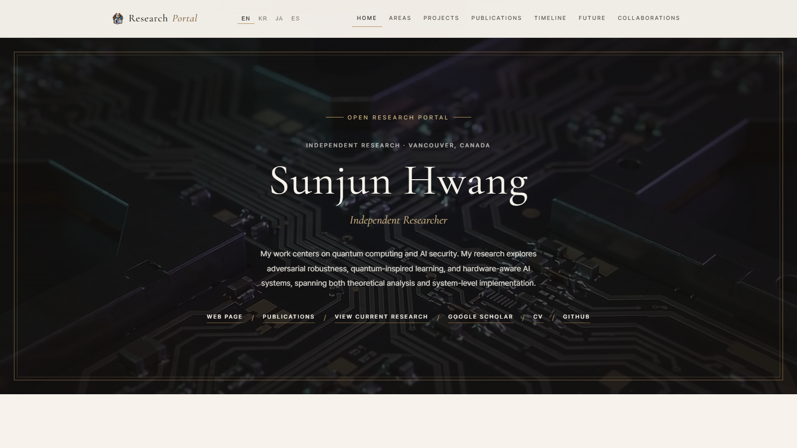

# Sunjun Hwang — Research Portal

The open research portal of **Sunjun Hwang (황선준)**: ongoing and completed work in AI security, quantum computing, autonomous driving, robotics and more, in four languages.

**Live site:** [sjhwangresearch.com](https://sjhwangresearch.com)



## About

Sunjun Hwang is an independent researcher based in Vancouver, Canada, working primarily on quantum computing and AI security. The work builds on undergraduate research at Yonsei University's [RAISE Lab](https://raise.yonsei.ac.kr/) and spans both theoretical analysis and system-level implementation.

This portal is one of three sites:

| Site | What it is |
|------|------------|
| [sjhwang.com](https://sjhwang.com) | Personal website ([myweb](https://github.com/justinbrianhwang/myweb)) |
| [sjhwangcv.com](https://sjhwangcv.com) | Curriculum vitae ([CV](https://github.com/justinbrianhwang/CV)) |
| [sjhwangresearch.com](https://sjhwangresearch.com) | Research portal (this repository) |

## Research Areas

| # | Area | Focus |
|---|------|-------|
| 1 | AI Security | Adversarial robustness, federated learning security, post-hoc defense, fault injection |
| 2 | Autonomous Driving | Federated learning and LLMs for autonomous driving |
| 3 | Quantum Computing & Communication | Quantum algorithms, NISQ circuits, VQC, BB84 key distribution |
| 4 | AI Semiconductors | Real-time AI on FPGA, AI accelerators, neuromorphic computing |
| 5 | Medical AI | Medical imaging, privacy-preserving hybrid quantum-classical models |
| 6 | Network / Communication Security | Robust modulation classification, quantum-secured networks |
| 7 | Computer Vision | Detection, segmentation, depth estimation, generative models |
| 8 | Robotics | Motion planning, manipulation, sim-to-real, multi-agent coordination |
| 9 | Large Language Models | Fine-tuning, RAG, multi-modal LLMs, alignment |
| 10 | Compilers | AI/ML, hardware-aware and quantum compilers |

## Features

- **Seven pages** — Home, Areas, Projects, Publications, Timeline, Future Research, Collaborations
- **Four languages** — English, Korean (한국어), Japanese (日本語), Spanish (Español), switchable at any time
- **Data-driven rendering** — all content lives in JS data files; the HTML is a shell
- **Research Map** — interactive diagram of how the ten areas connect
- **Progress tracking** — live progress bars for active projects
- **Design** — ivory, ink and antique-gold theme with serif display type (`css/theme.css`)
- **Responsive and accessible** — mobile navigation, reduced-motion support

## Project Structure

```
├── index.html              # Main entry point (Home)
├── html/                   # Sub-pages (areas, projects, publications, …)
├── sections/               # Reusable HTML section templates
├── css/
│   ├── variables.css       # Design tokens & CSS custom properties
│   ├── base.css            # Reset & typography
│   ├── layout.css          # Grid & layout utilities
│   ├── components.css      # Shared UI components
│   ├── theme.css           # Ivory / gold theme, loaded last
│   └── sections/           # Per-section styles
├── js/
│   ├── data/               # Content data (profile, projects, publications, …)
│   ├── i18n.js             # Internationalization & language toggle
│   ├── main.js             # Section loader & render orchestration
│   ├── navigation.js       # Nav bar & mobile menu
│   ├── progress.js         # Progress bar animations
│   └── timeline.js         # Timeline rendering
└── assets/
    ├── icons/              # Research area & section icons
    └── logos/              # Lab, university, and partner logos
```

## Getting Started

No build step required — this is a static site.

1. Clone the repository:
   ```bash
   git clone https://github.com/justinbrianhwang/sjhwangresearch.git
   ```
2. Open `index.html` in a browser, or serve locally:
   ```bash
   npx serve .
   ```

## Updating Content

All content lives in `js/data/` as plain JavaScript objects with multi-language keys:

```js
{
  en: "English text",
  ko: "한국어 텍스트",
  ja: "日本語テキスト",
  es: "Texto en español"
}
```

| File | Content |
|------|---------|
| `profile.js` | Name, title, affiliation, stats, links |
| `research-areas.js` | Core research domains |
| `projects.js` | Current active projects |
| `past-projects.js` | Completed research |
| `publications.js` | Papers & conference publications |
| `talks.js` | Presentations & seminars |
| `timeline-data.js` | Research milestones |
| `future-research.js` | Future directions & open questions |
| `collaborations.js` | Partner labs & industry collaborators |

## Deployment

Hosted on **GitHub Pages** with a custom domain (`sjhwangresearch.com`). Pushing to `main` automatically deploys.

## License

[Apache License 2.0](LICENSE)
